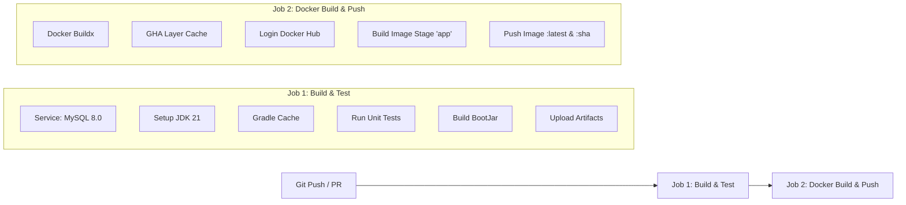

# HƯỚNG DẪN CHI TIẾT QUY TRÌNH CI (CONTINUOUS INTEGRATION) VỚI GITHUB ACTIONS

Tài liệu này giải thích quy trình CI cho ứng dụng Spring Boot 4 + Java 21 + MySQL + Docker.

---

## 1. CI (Continuous Integration) Là Gì?
**CI (Tích hợp liên tục)** là quy trình tự động hóa việc kiểm tra, build mã nguồn và đóng gói ứng dụng mỗi khi lập trình viên thực hiện `git push` hoặc tạo `Pull Request`.

Mục tiêu chính:
- **Phát hiện lỗi sớm:** Tự động chạy Unit Test, nếu có bug sẽ báo đỏ ngay lập tức.
- **Tính nhất quán:** Build trên môi trường độc lập (GitHub Runner) loại bỏ lỗi "chạy được trên máy tôi nhưng lỗi trên máy khác".
- **Sẵn sàng bàn giao (CD):** Tạo sẵn Docker Image đóng gói hoàn chỉnh đưa lên Registry.

---

## 2. Kiến Trúc Pipeline CI Trong Dự Án Này

File cấu hình: [`.github/workflows/ci.yml`](file:///d:/devops/session10-springboot/.github/workflows/ci.yml)



---

## 3. Chi Tiết Các Công Đoạn (Jobs & Steps)

### Job 1: `build-and-test`
1. **Khởi tạo MySQL Service Container:**
   - Khi chạy test Spring Boot JPA, Spring Boot cần kết nối Database để kiểm tra Entity/Hibernate context.
   - GitHub Actions tự động dựng một container `mysql:8.0` độc lập với cấu hình `MYSQL_DATABASE=productdb`.
2. **Cài đặt JDK 21 & Gradle Cache:**
   - Dùng Java 21 Eclipse Temurin.
   - Cache các thư viện `.gradle` tự động giúp các lần chạy sau tiết kiệm từ 1-3 phút.
3. **Thực thi Unit Test (`./gradlew test`):**
   - Biến môi trường trỏ trực tiếp vào MySQL container: `jdbc:mysql://127.0.0.1:3306/productdb`.
   - Báo cáo kết quả test (`test-reports`) luôn được lưu trữ lại trong mục Artifacts của GitHub Actions.
4. **Đóng gói Boot JAR (`./gradlew bootJar`):**
   - Tạo file `.jar` và lưu vào GitHub Artifacts (`app-jar`) để lưu trữ trong 7 ngày.

### Job 2: `docker-build` (Phụ thuộc Job 1 thành công)
1. **Docker Buildx & GitHub Actions Cache (`type=gha`):**
   - Cache lại các layer build (như Gradle dependencies trong Stage 1 của Dockerfile) trực tiếp trên GitHub runner.
2. **Đăng nhập Docker Hub:**
   - Sử dụng GitHub Secrets (`DOCKERHUB_USERNAME`, `DOCKERHUB_TOKEN`).
   - *Lưu ý:* Nếu bạn chưa cấu hình secrets này, job vẫn build Docker image bình thường để kiểm tra tính hợp lệ của [Dockerfile](file:///d:/devops/session10-springboot/Dockerfile) mà không bị báo lỗi.
3. **Build & Tag & Push:**
   - Tag theo commit hash ngắn (ví dụ: `sha-a1b2c3d`) và tag `latest`.
   - Khi merge vào nhánh `main`, image sẽ tự động được push lên Registry.

---

## 4. Các Bước Cấu Hình GitHub Secrets (Để Push Lên Docker Hub)

Nếu bạn muốn CI tự động push Docker Image lên Docker Hub của bạn:

1. **Lấy Access Token từ Docker Hub:**
   - Truy cập: [Docker Hub](https://hub.docker.com/) -> Đăng nhập.
   - Vào **Account Settings** -> **Security** -> **New Access Token**.
   - Đặt tên (vd: `github-actions-ci`) -> Copy mã Token (chuỗi `dckr_pat_...`).

2. **Thêm Secret vào Repository trên GitHub:**
   - Mở repository của bạn trên GitHub: `https://github.com/Ntttho/productservice001-demo-devops-docker`.
   - Vào tab **Settings** -> Mục bên trái chọn **Secrets and variables** -> **Actions**.
   - Bấm **New repository secret**:
     - `DOCKERHUB_USERNAME`: Tên tài khoản Docker Hub của bạn.
     - `DOCKERHUB_TOKEN`: Token vừa copy ở bước 1.

---

## 5. Cách Đẩy Mã Nguồn Lên GitHub Để Kích Hoạt CI

Mở terminal trong thư mục dự án và chạy các lệnh:

```bash
# Kiểm tra file đã tạo
git status

# Thêm file workflow
git add .github/workflows/ci.yml HUONG_DAN_CI.md

# Commit
git commit -m "feat(ci): add GitHub Actions CI pipeline for Spring Boot and Docker"

# Đẩy lên GitHub
git push origin main
```

Sau khi push:
1. Mở repo trên GitHub, bấm vào tab **Actions**.
2. Bạn sẽ thấy workflow **"CI - Spring Boot & Docker Pipeline"** đang chạy.
3. Bấm vào chi tiết để xem log trực tiếp từng bước của `build-and-test` và `docker-build`.
